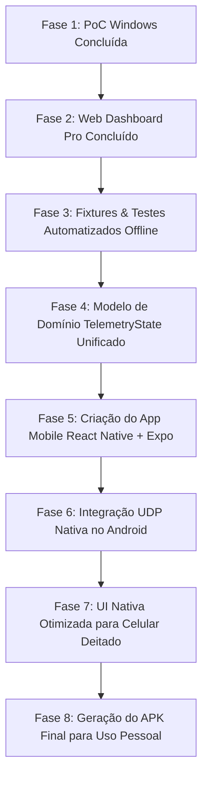

# 🏎️ F1 Telemetry Dashboard — Arquitetura, Conceito e Roadmap

Documento técnico e conceitual do projeto de telemetria em tempo real para o **EA SPORTS™ F1® 25 no PlayStation 5**, desenvolvido em TypeScript e Node.js, com evolução planejada para um aplicativo nativo em **React Native (Android APK)**.

---

# PARTE 1 — Proposta, Ideia do Projeto e Conceito

## 1.1 Visão Geral e Motivação
Pilotos virtuais e entusiastas de automobilismo frequentemente necessitam de informações críticas de corrida durante a pilotagem — como distribuição de freio, desgaste de pneus, temperatura de superfície e carcaça, energia do ERS (bateria híbrida), tempos de setor e danos aerodinâmicos — que muitas vezes ocupam a visão na tela principal da TV ou exigem navegação manual nos menus MFD do volante.

Soluções comerciais existentes (como SIM Dashboard) muitas vezes exigem assinaturas, configurações complexas ou dependem de servidores externos. 

O **F1 Telemetry Dashboard** nasce como uma solução **100% pessoal, autônoma, gratuita e de altíssima fidelidade**, inspirada nos volantes reais de Fórmula 1 e nas telas de telemetria de engenharia (MoTeC / Cosworth).

```
┌──────────────────────────────────────────────────────────────────────────┐
│                             REDE LOCAL (WI-FI)                           │
│                                                                          │
│  ┌───────────────────────┐                    ┌───────────────────────┐  │
│  │     PS5 (F1 25)       │                    │    Dispositivo Alvo   │  │
│  │                       │ ── UDP Telemetry ─►│   (PC / Smartphone)   │  │
│  │ Formato 2026 (60 Hz)  │    (Porta 20777)   │   Receptor + Parser   │  │
│  └───────────────────────┘                    │       Dashboard       │  │
│                                               └───────────────────────┘  │
│                                                                          │
│                     SEM CLOUD • SEM SERVIDORES • SEM INTERNET            │
└──────────────────────────────────────────────────────────────────────────┘
```

## 1.2 Princípios e Filosofia de Design
1. **Comunicação Não Invasiva e Oficial**: Não há tentativa de modificação do jogo, engenharia reversa de hardware ou conexão direta ao console. Todo o fluxo utiliza o protocolo UDP oficial da Codemasters/EA Sports.
2. **Custo Zero e Autonomia Local**: O sistema opera exclusivamente na rede local (Wi-Fi/Ethernet). Nenhum dado sai para a internet, não há servidores cloud, nem mensalidades.
3. **Primeiro Provar, Depois Construir**:
   - **Fase 1 (PoC no Windows)**: Provar o socket UDP, a deserialização binária dos pacotes reais do PS5 e a estabilização de frequência. *(Concluída com Sucesso)*.
   - **Fase 2 (Web Dashboard Pro)**: Validar todos os sistemas integrados (ERS, Danos, Pneus, Voltas) em uma interface rica. *(Concluída com Sucesso)*.
   - **Fase 3 (Mobile React Native / Android APK)**: Criar o aplicativo definitivo para smartphone/tablet deitado no cockpit, operando sem computador.

---

# PARTE 2 — Próximos Passos e Processo Futuro

## 2.1 Visão Geral do Roadmap



---

## 2.2 Detalhamento das Próximas Fases

### Fase 3: Fixtures e Testes Automatizados Offline
- **Gravação de Sessão Real**: Criar um utilitário simples no receptor para salvar 100–200 pacotes binários reais do PS5 em arquivos `.bin` (ex: `tests/fixtures/car-telemetry-2026.bin`, `lap-data-2026.bin`, `car-damage-2026.bin`).
- **Suíte de Testes com Dados Reais**: Garantir que alterações no parser sejam testadas instantaneamente sem precisar ligar o console toda vez.

### Fase 4: Modelo de Domínio Unificado
- Isolar completamente a camada de parsing de qualquer detalhe de transporte.
- O objeto consolidado (`FullTelemetrySnapshot`) servirá como a única fonte de verdade para qualquer consumidor (seja o Web Dashboard via WebSocket ou o aplicativo React Native via estado nativo).

### Fase 5: Aplicativo Mobile em React Native (Android)
- **Stack Tecnológica**:
  - React Native + TypeScript.
  - Expo (com **Expo Prebuild / Development Build** para habilitar módulos nativos de rede C++/Java).
  - Gerenciamento de Estado: **Zustand** (ultraleve e com renderizações atômicas sem re-renders desnecessários).
  - Animações e Gráficos: **React Native Reanimated** ou **Shopify/Skia** para 60 FPS garantidos na thread de UI.

### Fase 6: Módulo UDP Nativo no Android
- O Android não possui o módulo `dgram` do Node.js nativamente.
- Utilizaremos a biblioteca nativa `react-native-udp` (ou `react-native-sockets`) compilada no build de desenvolvimento do Expo.
- O parser TypeScript já construído será importado diretamente para dentro do app mobile, pois foi escrito em TypeScript puro sem dependências pesadas de Node.js.

### Fase 7: Dashboard Mobile Otimizado (Landscape / Celular Deitado)
- Layout projetado para celular acoplado no volante ou suporte:
  - Elementos de altíssimo contraste (visibilidade rápida com visão periférica).
  - Cores térmicas e indicadores luminosos (Shift lights, DRS, Bandeiras FIA).
  - Múltiplas telas selecionáveis por toque (Tela Principal de Corrida, Tela de Pneus & Freios, Tela de Danos e Engenharia).

### Fase 8: Build e Instalação via APK
- Geração do `.apk` de produção sem necessidade de publicação na Google Play Store.
- Instalação direta no smartphone/tablet Android via cabo USB ou download local.

---

# PARTE 3 — Descrição Técnica Detalhada dos Componentes

## 3.1 O Protocolo UDP do F1 25 (Formato 2026)

O jogo transmite dados binários compactados utilizando alinhamento de 1 byte (estruturas *packed*) e ordem de bytes **Little-Endian**.

### Estrutura do Header Oficial (29 Bytes)
Presente nos primeiros 29 bytes de **TODOS** os pacotes transmitidos pelo jogo:

| Offset (Bytes) | Campo | Tipo | Descrição |
| :--- | :--- | :--- | :--- |
| `0..1` | `m_packetFormat` | `uint16` | Ano do formato (ex: `2026` para F1 25 com pack 2026) |
| `2` | `m_gameYear` | `uint8` | Dois últimos dígitos do ano (ex: `25`) |
| `3` | `m_gameMajorVersion` | `uint8` | Versão Major (ex: `1`) |
| `4` | `m_gameMinorVersion` | `uint8` | Versão Minor (ex: `12`) |
| `5` | `m_packetVersion` | `uint8` | Versão do tipo de pacote (inicia em 1) |
| `6` | `m_packetId` | `uint8` | ID do pacote (0 a 14) |
| `7..14` | `m_sessionUID` | `uint64` | Identificador único global da sessão |
| `15..18` | `m_sessionTime` | `float32` | Timestamp da sessão em segundos |
| `19..22` | `m_frameIdentifier` | `uint32` | Contador do frame |
| `23..26` | `m_overallFrameIdentifier` | `uint32` | Contador cumulativo (não reseta com flashback) |
| `27` | `m_playerCarIndex` | `uint8` | **Índice do carro do jogador no grid (0 a 23)** |
| `28` | `m_secondaryPlayerCarIndex` | `uint8` | Índice do segundo jogador (splitscreen) ou `255` |

---

## 3.2 Arquitetura em Camadas e Pipeline de Dados

```text
┌────────────────────────────────────────────────────────────────────────┐
│                        CAMADA DE TRANSPORTE UDP                        │
│   UdpReceiver (dgram.Socket ouvindo na porta 20777 em 0.0.0.0)         │
│   Taxa de ingestão: ~328 pacotes/segundo (sem descarte)                │
└──────────────────────────────────┬─────────────────────────────────────┘
                                   │
                                   ▼
┌────────────────────────────────────────────────────────────────────────┐
│                      CAMADA DE PARSING BINÁRIO                         │
│   ParserRegistry -> Roteamento por Packet ID (0..14)                   │
│   ├── HeaderParser (29 bytes)                                          │
│   ├── TelemetryParser (ID 6: 1448 bytes - 24 carros x 59b)            │
│   ├── CarStatusParser (ID 7: ERS, Combustível, Pneus, DRS, Bandeiras)   │
│   ├── CarDamageParser (ID 10: Asas, Assoalho, Câmbio, Motor, Desgaste) │
│   └── LapDataParser (ID 2: Tempos de Volta, Setores, Posição)          │
└──────────────────────────────────┬─────────────────────────────────────┘
                                   │
                                   ▼
┌────────────────────────────────────────────────────────────────────────┐
│                    CAMADA DE ESTADO (TELEMETRY STORE)                  │
│   TelemetryStore (Singleton em memória)                                │
│   - Atualização atômica in-place                                       │
│   - Desacoplamento total de eventos de rede                            │
└──────────────────────────────────┬─────────────────────────────────────┘
                                   │
                                   ▼
┌────────────────────────────────────────────────────────────────────────┐
│                   CAMADA DE BROADCAST (SNAPSHOTS A 30 HZ)              │
│   TelemetryWebServer (Timer fixo de ~33.3ms)                           │
│   - Consolidação do estado                                             │
│   - Envio de exatamente 30 mensagens/s via WebSocket                   │
└──────────────────────────────────┬─────────────────────────────────────┘
                                   │
                                   ▼
┌────────────────────────────────────────────────────────────────────────┐
│                     CAMADA DE APRESENTAÇÃO (UI WEB)                    │
│   public/index.html (HTML5 / CSS3 / Vanilla JS)                        │
│   - Elementos DOM cacheados uma única vez (Zero innerHTML)             │
│   - Sample-and-Hold de texto a 10 Hz (leitura nítida de dígitos)       │
│   - Atualização instantânea para marcha e bandeiras                    │
│   - Shift Lights 15 LEDs + ERS Boost + Pneus 4 Rodas + Danos           │
└────────────────────────────────────────────────────────────────────────┘
```

---

## 3.3 Catálogo Detalhado de Arquivos e Funções

### `src/models/` (Tipagem Estrita)
* [`packet-ids.ts`](file:///c:/Projetos/F1%20Dash/src/models/packet-ids.ts): `enum PacketId` contendo todos os 15 identificadores oficiais (`Motion=0`, `Session=1`, `LapData=2`, `CarTelemetry=6`, `CarStatus=7`, `CarDamage=10`, etc.).
* [`header.ts`](file:///c:/Projetos/F1%20Dash/src/models/header.ts): Interface TypeScript que mapeia o cabeçalho de 29 bytes.
* [`car-telemetry.ts`](file:///c:/Projetos/F1%20Dash/src/models/car-telemetry.ts): Estrutura `CarTelemetryData` (Velocidade, RPM, Marcha, Acelerador, Freio, Direção, DRS, Temperaturas de Freio e Pneus).
* [`car-status.ts`](file:///c:/Projetos/F1%20Dash/src/models/car-status.ts): Estrutura `CarStatusData` (Bateria ERS, Modo Boost/Overtake, Combustível em kg, Bandeiras da FIA, Composto Visual de Pneu).
* [`car-damage.ts`](file:///c:/Projetos/F1%20Dash/src/models/car-damage.ts): Estrutura `CarDamageData` (Danos de Asa Dianteira L/R, Asa Traseira, Assoalho, Difusor, Câmbio, Desgaste do Motor ICE/MGU-K/MGU-H).
* [`lap-data.ts`](file:///c:/Projetos/F1%20Dash/src/models/lap-data.ts): Estrutura `LapData` (Tempo da volta atual, última volta, Setor 1, Setor 2, Posição no grid `P1..P24`, Penalidades).

### `src/utils/` (Operações de Baixo Nível)
* [`buffer-reader.ts`](file:///c:/Projetos/F1%20Dash/src/utils/buffer-reader.ts): Wrapper de alta performance sobre o `Buffer` do Node.js com métodos de leitura Little-Endian (`readUInt8`, `readInt8`, `readUInt16LE`, `readInt16LE`, `readUInt32LE`, `readFloatLE`, `readBigUInt64LE`) e validação rigorosa de limites (*bounds checking*).
* [`formatters.ts`](file:///c:/Projetos/F1%20Dash/src/utils/formatters.ts): Utilitários visuais para o console terminal (barras de progresso ANSI, cores de rotação e formatação de bytes).

### `src/parser/` (Decodificadores Binários)
* [`header-parser.ts`](file:///c:/Projetos/F1%20Dash/src/parser/header-parser.ts): Decodifica os 29 bytes do cabeçalho e fornece o método ultrarrápido `peekPacketId(buffer)` para inspecionar o byte no offset 6 sem alocar memória extra.
* [`telemetry-parser.ts`](file:///c:/Projetos/F1%20Dash/src/parser/telemetry-parser.ts): Decodifica o pacote ID 6 com suporte dual:
  - **Formato 2026 (1448 bytes)**: 24 carros x 59 bytes cada (`m_engineTemperature` é `uint8`).
  - **Formato 2024 (1352 bytes)**: 22 carros x 60 bytes cada (`m_engineTemperature` é `uint16`).
* [`car-status-parser.ts`](file:///c:/Projetos/F1%20Dash/src/parser/car-status-parser.ts): Decodifica o pacote ID 7 (ERS, Combustível, Pneus, Flags).
* [`car-damage-parser.ts`](file:///c:/Projetos/F1%20Dash/src/parser/car-damage-parser.ts): Decodifica o pacote ID 10 (Asas, Assoalho, Câmbio, Motor).
* [`lap-data-parser.ts`](file:///c:/Projetos/F1%20Dash/src/parser/lap-data-parser.ts): Decodifica o pacote ID 2 (Tempos, Posição, Setores).
* [`parser-registry.ts`](file:///c:/Projetos/F1%20Dash/src/parser/parser-registry.ts): Roteador central que distribui buffers para os parsers especializados.

### `src/state/` (Armazenamento de Estado)
* [`telemetry-store.ts`](file:///c:/Projetos/F1%20Dash/src/state/telemetry-store.ts): Centraliza o objeto `FullTelemetrySnapshot`. Atualiza apenas os campos mutados conforme os pacotes chegam (sem dependência de timers ou disparo imediato de eventos).

### `src/udp/` e `src/server/` (Comunicação de Rede)
* [`receiver.ts`](file:///c:/Projetos/F1%20Dash/src/udp/receiver.ts): Socket UDP `dgram` com cálculo em tempo real de vazão de pacotes por segundo (`packetsPerSecond`), bytes/s e totalizadores.
* [`web-server.ts`](file:///c:/Projetos/F1%20Dash/src/server/web-server.ts): Servidor HTTP nativo (porta 3000) e servidor WebSocket (`ws`). Contém o método `startSnapshotBroadcaster()` que dispara snapshots periódicos em **30 Hz fixos**.

### `src/diagnostic.ts` (Ferramenta de Auditoria)
* Script CLI especializado para auditoria de baixo nível. Exibe o IP de origem do transmissor, tamanho bruto em bytes, Session UID, e dumps hexadecimais do Header e do carro do jogador.

### `public/index.html` (Interface do Cockpit Pro)
* Painel visual completo sem frameworks pesados:
  - **Shift Lights (15 LEDs)**: 5 Verdes, 5 Vermelhos e 5 Azuis com flash no limitador.
  - **Cockpit Central**: Marcha gigante de alto contraste, Velocidade em km/h, RPM e Temperatura do Motor.
  - **Badges de Alta Frequência**: DRS (`DRS PRONTO` / `DRS ATIVO`) e ERS (`⚡ BOOST / RETA`, `HOTLAP`, `MEDIUM`, `NONE`).
  - **Pneus e Freios (4 Rodas)**: Composto (Soft, Medium, Hard, Inter, Wet), Idade em voltas, Desgaste %, Temperatura de Superfície e Pressão PSI.
  - **Danos**: Asas dianteiras L/R, Asa traseira, Assoalho, Difusor, Câmbio e Motor.
  - **Tempos & Corrida**: Posição na corrida (`P1..P24`), Tempo atual (mm:ss.ms), Última volta, Setor 1 e Setor 2, e Bandeiras FIA (Verde, Amarela, Vermelha, Azul).

---

## 3.4 Guia Rápido de Comandos

| Comando | Descrição |
| :--- | :--- |
| `npm run dev` | Inicia o receptor UDP (porta 20777) e o Web Dashboard (porta 3000) |
| `npm run diag` | Executa o modo de diagnóstico de pacotes brutos RAW e IPs de origem |
| `npm test` | Executa a suíte de testes unitários com validação dos formatos 2026 e 2024 |
| `npm run build` | Compila o código TypeScript para a pasta `dist/` |
