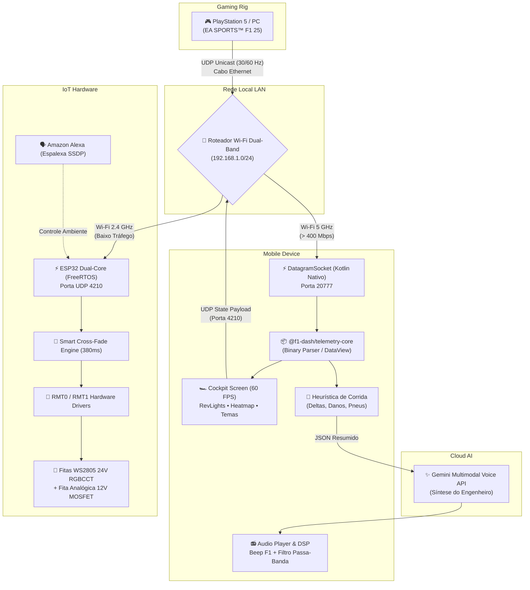

# 🏎️ F1 Telemetry Ecosystem & Cockpit Display

[](https://www.ea.com/games/f1/f1-25)
[](https://reactnative.dev/)
[](https://platformio.org/)
[](https://deepmind.google/technologies/gemini/)
[-orange.svg)]()

Ecossistema completo de telemetria automotiva de **baixa latência (< 2 ms)** para o **EA SPORTS™ F1® (F1 25 / F1 26)**, projetado para pilotagem imersiva profissional sem intermediários em nuvem. 

O sistema integra visualização em tempo real no volante/smartphone, engenheiro de corrida autônomo com Inteligência Artificial generativa de voz e iluminação cênica dinâmica de alta potência na bancada.

---

## 🏛️ Os 3 Pilares do Sistema

```
┌────────────────────────────────────────────────────────────────────────┐
│                        F1 TELEMETRY ECOSYSTEM                          │
├───────────────────┬───────────────────────────┬────────────────────────┤
│   PILAR 1: APP    │   PILAR 2: CLAUDINHO IA   │   PILAR 3: ESP32 IoT   │
│ (React Native/    │ (Gemini Voice Engine &    │  (C++ Firmware / RMT / │
│  Kotlin Nativo)   │   Edge Race Heuristics)   │  Eletrônica de Potência)│
└───────────────────┴───────────────────────────┴────────────────────────┘
```

### 1. 📱 Dashboard Cockpit Mobile (`mobile-app/`)
* **Pipeline Gráfico 60 FPS:** Interface em orientação Landscape com layouts *Cockpit Realista* e *Modo Moderno*.
* **RevLights / Shift Lights:** Barra periférica de 15 LEDs virtuais com cálculo dinâmico de RPM e alerta visual de troca de marcha.
* **Car Damage Heatmap (SVG Vetorial):** Mapa térmico em tempo real de 5 estágios para Asas, Assoalho, Sidepods, Câmbio e Motor.
* **Ingestão UDP Nativa (Kotlin/Android):** Módulo nativo via JNI que abre `DatagramSocket` diretamente no hardware do celular, eliminando gargalos de rede e processando pacotes na porta `20777`.
* **Multi-Regulamento F1 (2025 vs 2026):** Suporte nativo ao novo regulamento de *Active Aero (X-Mode / Z-Mode)* e *Overtake Boost* com validação de delta ($\Delta < 1.0\text{s}$) e ERS.

### 2. 🎙️ Claudinho Ronaldo — Engenheiro de Corrida IA
* **Ouvinte Heurístico de Borda:** Detector algorítmico que monitora o fluxo de telemetria identificando desgaste de pneus (> 60%), perdas de ritmo, deltas de perseguição e bandeiras.
* **Fila de Prioridade & Anti-Spam (Histerese):** Máquina de estados que impede mensagens repetidas e prioriza alertas críticos (batidas, falhas mecânicas) sobre atualizações rotineiras.
* **Síntese Vocal com Gemini Voice API:** Geração contextual de voz com personalidade brasileira de alta intensidade.
* **Audio DSP de Transmissão:** Pós-processamento com chime oficial da F1 (`radio_beep.mp3`), filtro passa-banda acústico (300 Hz – 3 kHz) simulando o intercomunicador dos pilotos e envelope de onda visual animado.

### 3. 💡 Iluminação G7 Desk F1 (`esp32-fw/`)
* **Eletrônica de Potência Dual-Rail:** Distribuição mista de **24V DC** para fitas digitais WS2805 e **12V DC** com MOSFETs para fita analógica ambiente.
* **Controle por Hardware RMT (Sub-microssegundo):** Fitas WS2805 RGBCCT de 5 canais (RGB + Branco Quente + Branco Frio) controladas pelos canais dedicados `RMT0` e `RMT1` do ESP32, sem travamento de CPU.
* **Smart Cross-Fade ($3t^2 - 2t^3$):** Transição suave de buffer cúbico entre modos de luz (ex: o roxo do Modo Reta ou azul do Overtake se dissolvem organicamente em **380 ms** no Branco Quente de repouso).
* **Smart Home & Servidor Web:** Servidor assíncrono embutido na memória Flash (PROGMEM) com interface Dark Mode e integração nativa com **Amazon Alexa via SSDP/UPnP** (`Espalexa`).

---

## 📐 Arquitetura de Rede e Fluxo de Dados



---

## 🛠️ Destaques de Engenharia & Resolução de Problemas

> [!IMPORTANT]
> ### 1. Mitigação do "Broadcast Storm" L2 no Wi-Fi 802.11
> **Problema:** Ao usar *UDP Broadcast* no jogo, mesmo com o console conectado no cabo Ethernet, o roteador replicava os quadros `FF:FF:FF:FF:FF:FF` obrigatoriamente na antena 2.4 GHz na menor taxa básica da norma (1 Mbps), consumindo 100% do *airtime* e causando **75% de perda de pacotes e > 3.000 ms de atraso no ESP32**.  
> **Solução:** Implementação de arquitetura **Unicast Estrita** direcionando os pacotes do PS5 exclusivamente para o IP 5 GHz do smartphone. O canal 2.4 GHz ficou 100% desimpedido, reduzindo a latência do ESP32 para estáveis **62 ms com 0% de perda**.

> [!TIP]
> ### 2. Parsing Binário com Zero Garbage Collection Overhead
> O protocolo da Codemasters transmite estruturas compactadas em alinhamento de 1 byte. Em vez de instanciar milhares de objetos temporários no JavaScript por segundo, o `@f1-dash/telemetry-core` lê campos diretamente sobre um único `ArrayBuffer` reutilizado via offsets fixos, garantindo fluidez contínua a 60 FPS sem engasgos de GC.

> [!NOTE]
> ### 3. Cross-Fade Cúbico por Interpolação de Buffer nos LEDs
> Ao alternar entre efeitos de alta intensidade (Modo Reta / Overtake) e a iluminação ambiente de repouso, o firmware do ESP32 captura um snapshot de 750 bytes da memória e aplica a função de interpolação:
> $$\text{corFinal} = \text{lerp}(\text{corAntiga}, \text{corNova}, 3t^2 - 2t^3)$$
> Isso remove cortes bruscos nos 5 canais físicos dos LEDs e entrega um efeito visual orgânico e cinematográfico.

---

## 📂 Estrutura do Repositório (Monorepo)

```
F1-Dash/
├── mobile-app/               # Aplicativo React Native (Expo Bare Workflow)
│   ├── android/              # Código nativo Kotlin / Módulo ExpoUdpModule
│   ├── assets/               # Assets de áudio oficial, fontes F1 e fotos
│   ├── src/
│   │   ├── cockpit/          # Temas dinâmicos e componentes visuais do volante
│   │   ├── components/       # Danos em SVG, RevLights e Banner de Team Radio
│   │   ├── screens/          # CockpitScreen e MenuScreen de configuração
│   │   └── services/         # Ingestão UDP, Claudinho IA e envio para ESP32
│   └── eas.json              # Configuração de compilação em nuvem (EAS Build)
├── esp32-fw/                 # Firmware C++ completo para ESP32 (PlatformIO)
│   ├── src/
│   │   ├── communication/    # Receptor de pacotes UDP na porta 4210
│   │   ├── config/           # Pinagem de hardware, tempos e rede
│   │   ├── effects/          # Engine de efeitos visuais e Smart Cross-Fade
│   │   ├── leds/             # Drivers WS2805 via RMT e PWM MOSFET
│   │   ├── modes/            # Modo F1, Modo Ambiente e Servidor Web HTTP
│   │   └── state/            # Máquina de estados e hierarquia de eventos
│   └── platformio.ini        # Configuração de build, bibliotecas e partições
├── packages/
│   └── telemetry-core/       # Biblioteca compartilhada de parsing binário oficial F1
└── web-server/               # Servidor de apoio em Node.js (UDP relay / Vite web)
```

---

## 🚦 Guia de Configuração Rápida

### 1. Configuração de Telemetria no Jogo (PS5 / PC)
Nas opções de **Configurações de Telemetria** do F1 25 / F1 26:
* **Telemetria por UDP:** `Sim`
* **Modo de transmissão por UDP:** `Não` *(Obrigatório Unicast)*
* **Endereço IP do UDP:** Digite o IP do celular na rede Wi-Fi 5 GHz *(ex: `192.168.1.xxx` exibido na tela inicial do app)*
* **Porta de UDP:** `20777`
* **Taxa de envio de UDP:** `30 Hz` ou `60 Hz`
* **Formato de UDP:** `2026` (ou `2025`)

### 2. Gravando o Firmware no ESP32
Conecte a placa via USB e utilize o PlatformIO:
```bash
cd esp32-fw
pio run --target upload
```
*Após a gravação, o ESP32 se conecta automaticamente ao Wi-Fi configurado e disponibiliza o painel Web em `http://192.168.1.103`.*

### 3. Rodando o Aplicativo Mobile
Instale o APK pré-compilado diretamente no Android ou execute via ambiente de desenvolvimento:
```bash
cd mobile-app
npm install
npx expo run:android
```

---

## 📄 Licença
Distribuído sob a licença **MIT**. Desenvolvido para uso pessoal e entusiastas de automobilismo virtual.
