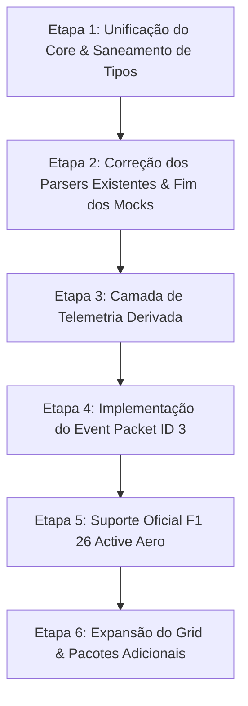

# 🏎️ AUDITORIA COMPLETA DA TELEMETRIA UDP — F1 DASH

> **Data da Auditoria:** 05 de Setembro de 2026  
> **Escopo:** Telemetria, parsing binário, gerenciamento de estado, cálculos derivados e arquitetura de dados (F1 25 e F1 26).  
> **Status:** Diagnóstico concluído. Nenhuma refatoração ou alteração de UI executada.

---

## 1. Executive Summary

O projeto **F1 Dash** tem como objetivo fornecer um dashboard de telemetria em tempo real para EA SPORTS™ F1® 25 / F1® 26, com foco em consoles (PS5) transmitindo via UDP (porta 20777).

### Principais Conclusões:
1. **Fragmentação Arquitetural Severa (Dois Cores Paralelos):**
   O repositório possui duas implementações distintas e divergentes do motor de telemetria:
   - **Camada Node.js Legada (`src/models`, `src/parser`, `src/utils/buffer-reader.ts`):** Depende do objeto global `Buffer` do Node. Suporta o pacote 15 (`CarTelemetry2`), mas **não possui** parser para o pacote 1 (`Session`).
   - **Camada Universal Cross-Platform (`src/core/models`, `src/core/parser`, `src/core/utils/binary-reader.ts`):** Baseada em `DataView`/`Uint8Array`. Suporta o pacote 1 (`Session`), mas **não possui** suporte para o pacote 15 (`CarTelemetry2`).
   - Adicionalmente, a pasta `mobile-app/src/core` é uma cópia bifurcada de `src/core`, e a pasta `web-server/` é uma duplicata quase idêntica de toda a raiz do repositório.

2. **Cobertura Parcial de Pacotes UDP (5 de 17 suportados):**
   Dos 17 pacotes oficiais do ecossistema F1 (IDs 0 a 16):
   - Apenas **5 pacotes** possuem algum nível de decodificação funcional: `Session (1)`, `LapData (2)`, `CarTelemetry (6)`, `CarStatus (7)` e `CarDamage (10)`. O pacote `CarTelemetry2 (15)` só existe no core Node legado.
   - Pacotes vitais como `Motion (0)`, `Event (3)`, `Participants (4)`, `CarSetups (5)`, `TyreSets (12)` e `LapPositions (16)` estão **completamente ausentes**.

3. **Inexistência de Camada de Dados Derivados (Derived Telemetry Layer):**
   Não existe separação formal entre dados RAW e dados DERIVADOS.
   - Cálculos críticos (ex: porcentagem de RPM, seleção de LEDs de shift-light, cálculo de tempo de volta e deltas) estão **espalhados diretamente dentro de componentes visuais do React** (`App.tsx`, `CockpitScreen.tsx`, `TimingCard.tsx`, `ShiftLightsBar.tsx`).
   - Métricas fundamentais de corrida (consumo de combustível por volta, delta de combustível, desgaste de pneu estimado por volta, vida útil remanescente de pneu, tempo do Setor 3 e gaps relativos) **não são calculadas em lugar nenhum**.

4. **Descarte Imediato de Dados do Grid (Single-Car Monolithic):**
   Embora os pacotes UDP entreguem os dados dos 22/24 carros do grid, os parsers e o `TelemetryStore` descartam imediatamente os dados dos outros 23 pilotos, guardando apenas o `playerCarIndex`. Isso impossibilita telemetria comparativa, telemetria do companheiro de equipe, gaps dinâmicos reais e tabela de classificação (leaderboard).

5. **Dados Falsos e Mascaramento de Telemetria (Fallbacks Ilusórios):**
   No app mobile (`mobile-app/src/screens/CockpitScreen.tsx`), os componentes de tela utilizam operadores de coalescência nula (`??`) com valores fixos ultra-realistas (ex: Posição `3`, Marcha `7`, Velocidade `375 km/h`, RPM `7600`, Pneus `[25, 23, 18, 21]`, Delta `-247ms`). Na ausência de sinal UDP ou de campos válidos, o cockpit exibe uma corrida fantasma ao invés de acusar ausência de dados.

6. **Bugs de Parsing e Interpretação Incorreta de Campos:**
   - **Bandeira Vermelha:** O parser de sessão interpreta `numRedFlagPeriods > 0` como bandeira vermelha ativa. No protocolo F1, este campo é um contador acumulativo de quantas bandeiras vermelhas já ocorreram na sessão; portanto, após a primeira bandeira vermelha, a tela fica travada em Bandeira Vermelha para sempre.
   - **Alinhamento de Sessão:** O parser pula previsões de tempo usando `Math.min(reader.remainingBytes(), 56 * 8)`, dessincronizando o cursor de leitura binária.
   - **Setor 3:** O protocolo da Codemasters não transmite o tempo do Setor 3 explicitamente; ele precisa ser derivado (`lastLapTime - sector1 - sector2`). O app simplesmente não possui o tempo do setor 3.

---

## 2. Current Architecture (Fluxo Real Encontrado no Código)

O fluxo arquitetural varia dependendo do ponto de entrada:

### Fluxo A: Desktop / Terminal / Web Server (`src/index.ts` + `public/index.html`)
```text
PS5 (UDP: 20777)
    │
    ▼
UdpReceiver (dgram.Socket em src/udp/receiver.ts)
    │  Buffer binário bruto (Node.js Buffer)
    ▼
ParserRegistry (src/parser/parser-registry.ts - CORE LEGADO)
    │  Chama HeaderParser.peekPacketId(buffer)
    ├── CarTelemetryParser (ID 6)
    ├── Telemetry2Parser (ID 15)
    ├── CarStatusParser (ID 7)
    ├── CarDamageParser (ID 10)
    └── LapDataParser (ID 2)
    │  (Sessão ID 1 é descartada / não existe parser neste core)
    ▼
TelemetryStore (src/state/telemetry-store.ts - Singleton)
    │  Atualiza snapshot monolítico em memória
    │  Descarta danos de assoalho/difusor/câmbio
    ├── Terminal Dashboard (Render a 2 Hz via stdout)
    └── TelemetryWebServer (src/server/web-server.ts)
           │ Broadcast a 30 Hz via WebSocket
           ▼
        Navegador Web (public/index.html - Vanilla JS)
```

### Fluxo B: Mobile React Native / Expo (`mobile-app/`)
```text
PS5 (UDP: 20777)
    │
    ▼
NativeUdpReceiver (mobile-app/src/services/native-udp-receiver.ts)
    │  Tenta @isvend/expo-udp -> fallback react-native-udp
    │  Recebe ArrayBuffer / Uint8Array
    ▼
ParserRegistry (mobile-app/src/core/parser/parser-registry.ts - CORE UNIVERSAL)
    │  Usa BinaryReader (DataView cross-platform)
    ├── TelemetryParser (ID 6)
    ├── SessionParser (ID 1)
    ├── LapDataParser (ID 2)
    ├── CarStatusParser (ID 7)
    └── CarDamageParser (ID 10)
    │  (ID 15 Telemetry2 NÃO EXISTE neste core)
    ▼
TelemetryStore (mobile-app/src/core/state/telemetry-store.ts)
    │  Descarta campos cruciais de dano e corrida
    ▼
TelemetryService (mobile-app/src/services/telemetry-service.ts)
    │  Alterna entre UDP_NATIVE, WEBSOCKET e MOCK
    │  Dispara callbacks manuais para listeners
    ▼
useCockpitTheme + React Screens (CockpitScreen.tsx)
    │  Componentes React extraem dados via props
    │  Valores ausentes são mascarados com hardcoded fallbacks
    └── Telas Momentâneas (Overlays baseados em flags estáticas)
```

---

## 3. Packet Support Matrix

Tabela comparativa frente ao protocolo oficial F1 25 / F1 26:

| Packet ID | Nome Oficial | Existe Parser? | Completo? | Campos Utilizados | Campos Faltando / Ignorados | Observações |
| :---: | :--- | :---: | :---: | :--- | :--- | :--- |
| **0** | **Motion** | ❌ Não | 0% | Nenhum | Todos (Posições X/Y/Z, Velocidades X/Y/Z, Forças G lat/long/vert, Yaw, Pitch, Roll) | Impede telemetria dinâmica, forças G e mapa da pista. |
| **1** | **Session** | ⚠️ Parcial | ~40% | `weather`, `trackTemperature`, `airTemperature`, `totalLaps`, `sessionType`, `trackId`, `sessionTimeLeft`, `safetyCarStatus`, `pitSpeedLimit`, `numRedFlagPeriods` | `weatherForecastSamples` (56/64 amostras), `air/track temp change`, `pitStopWindowIdealLap`, `pitStopWindowLatestLap`, `pitStopRejoinPosition`, `equalizer`, `sessionDuration`, zonas de bandeira | Presente apenas no core `core/`. Contém bug crítico no parsing de previsão e bandeira vermelha. |
| **2** | **Lap Data** | ⚠️ Parcial | ~60% | `lastLapTimeInMS`, `currentLapTimeInMS`, `sector1Time`, `sector2Time`, `deltaToCarInFront`, `deltaToRaceLeader`, `carPosition`, `currentLapNum`, `pitStatus`, `safetyCarDelta` | `sector3Time` (não calculado), `totalWarnings`, `cornerCuttingWarnings`, `numUnservedDriveThroughPens`, `numUnservedStopGoPens`, `gridPosition`, `driverStatus`, `resultStatus`, dados de 23 carros rivais | Apenas dados do jogador são armazenados. Deltas de tempo para o líder e carro à frente são mal interpretados. |
| **3** | **Event** | ❌ Não | 0% | Nenhum | Todos os eventos (`SSTA`, `SEND`, `FTLP`, `RTMT`, `DRSE`, `DRSD`, `TMPT`, `CHQF`, `RCWN`, `PENA`, `SPTP`, `STLG`, `LGOT`, `DTSV`, `SGSV`, `FLBK`, `RDFL`, `OVTK`) | **Grave:** Eventos temporais essenciais não são capturados do UDP. Overlays dependem de polling ou simulação manual. |
| **4** | **Participants** | ❌ Não | 0% | Nenhum | Nomes dos pilotos (48 chars UTF-8), IDs de equipe, nacionalidades, piloto controlado por IA, telemetria pública/privada | Impossibilita exibir nomes de rivais e logos reais de equipes. |
| **5** | **Car Setups** | ❌ Não | 0% | Nenhum | Asas dianteira/traseira, diferencial, cambagem, convergência, suspensão, barras estabilizadoras, pressão inicial dos pneus, carga de combustível | Dados essenciais de engenharia não recebidos. |
| **6** | **Car Telemetry** | 🟢 Sim | ~95% | `speed`, `throttle`, `steer`, `brake`, `clutch`, `gear`, `engineRPM`, `drs`, `revLightsPercent`, `revLightsBitValue`, `brakesTemperature`, `tyresSurfaceTemperature`, `tyresInnerTemperature`, `engineTemperature`, `tyresPressure` | `surfaceType[4]`, dados dos outros 23 carros, `mfdPanelIndex`, `suggestedGear` (lidos mas não usados na UI) | Parser mais robusto do sistema. Lida com 59 bytes (2026/F1 25) e 60 bytes (2024). |
| **7** | **Car Status** | 🟢 Sim | ~85% | `tractionControl`, `antiLockBrakes`, `fuelMix`, `frontBrakeBias`, `pitLimiterStatus`, `fuelInTank`, `fuelCapacity`, `fuelRemainingLaps`, `maxRPM`, `idleRPM`, `drsAllowed`, `visualTyreCompound`, `tyresAgeLaps`, `vehicleFiaFlags`, `ersStoreEnergy`, `ersDeployMode`, `ersHarvestedThisLapMGUK`, `ersDeployedThisLap` | `actualTyreCompound`, `enginePowerICE`, `enginePowerMGUK`, `ersHarvestedThisLapMGUH`, `networkPaused` | Bem implementado, mas os dados de coligados (outros carros) são jogados fora. |
| **8** | **Final Classification** | ❌ Não | 0% | Nenhum | Classificação final, tempo total, penalidades, stints de pneus utilizados | Tela final de corrida depende de trigger fake. |
| **9** | **Lobby Info** | ❌ Não | 0% | Nenhum | Nomes dos jogadores em multiplayer, plataformas, prontidão | Inexistente. |
| **10** | **Car Damage** | ⚠️ Parcial | ~60% | `tyresWear[4]`, `frontLeftWingDamage`, `frontRightWingDamage`, `rearWingDamage`, `engineDamage` | `tyresDamage[4]`, `brakesDamage[4]`, `floorDamage`, `diffuserDamage`, `sidepodDamage`, `drsFault`, `ersFault`, `gearBoxDamage`, `engineMGUHWear`, `engineESWear`, `engineCEWear`, `engineICEWear`, `engineMGUKWear`, `engineTCWear`, `engineBlown`, `engineSeized` | O parser lê os campos binários, mas o `TelemetryStore` descarta 70% deles antes de chegar na UI. |
| **11** | **Session History** | ❌ Não | 0% | Nenhum | Histórico volta a volta (até 100 voltas), stints de pneus de cada piloto, melhores setores históricos | Telemetria histórica não suportada. |
| **12** | **Tyre Sets** | ❌ Não | 0% | Nenhum | Todos os 20 sets de pneus da alocação do fim de semana (desgaste, voltas dadas, composto, set instalado) | Essencial para estratégia de box; ausente. |
| **13** | **Motion Ex** | ❌ Não | 0% | Nenhum | Curso de suspensão, velocidade de amortecedor, wheel slip ratio, wheel slip angle, forças laterais/longitudinais nos pneus | Telemetria avançada de chassis ausente. |
| **14** | **Time Trial** | ❌ Não | 0% | Nenhum | Carro fantasma pessoal, rival, deltas de volta rápida | Inexistente. |
| **15** | **Car Telemetry 2** | ⚠️ Parcial | ~35% | `activeAeroMode`, `activeAeroAvailable`, `activeAeroActivationDistance`, `overtakeModeActive`, `ersEnergyStore` | `overtakeAvailable`, `overtakeActivationDistance`, `driving wrong way`, detecção de regulamento 2026 nativa | **Só existe no core Node legado (`src/parser`)**. Inexistente no core universal (`src/core`) e no `mobile-app`. |
| **16** | **Lap Positions** | ❌ Não | 0% | Nenhum | Vetor de posições de todos os carros por volta | Inexistente. |

---

## 4. Telemetry Coverage

### 4.1 Vehicle / Motion
- **Implementados:** `speed`, `throttle`, `brake`, `steer`, `gear`, `engineRPM`, `engineTemperature`, `drs`, `revLightsPercent`, `revLightsBitValue`, `clutch`, `brakesTemperature[4]`.
- **Faltando:** `brakeBias` (lido no status, mas não exibido no cockpit mobile central), `wheelSpeed[4]` (MotionEx), `wheelSlipRatio[4]`, `wheelSlipAngle[4]`, `localVelocity[X,Y,Z]`, `gForceLateral`, `gForceLongitudinal`, `gForceVertical`.

### 4.2 Tyres
- **RAW UDP Existente:**
  - `tyresSurfaceTemperature[4]` (RL, RR, FL, FR)
  - `tyresInnerTemperature[4]` (RL, RR, FL, FR)
  - `tyresPressure[4]` (PSI)
  - `tyresWear[4]` (0 a 100%)
  - `visualTyreCompound` (Soft, Medium, Hard, Inter, Wet)
  - `tyresAgeLaps` (idade em voltas)
- **RAW UDP Descartado ou Faltando:**
  - `tyresDamage[4]` (descartado pelo store)
  - `brakesDamage[4]` (descartado pelo store)
  - `tyreSets` (Packet 12 ausente)
  - `puncture` (indicação binária de pneu furado do Car Damage)
- **DERIVED Faltando:**
  - `estimatedTyreLife`: inexistente.
  - `wearRatePerLap`: inexistente.
  - `estimatedLapsRemainingOnTyre`: inexistente.

### 4.3 ERS / Bateria
- **RAW UDP Existente:**
  - `ersStoreEnergy` (Joules)
  - `ersDeployMode` (0=None, 1=Medium, 2=Hotlap, 3=Overtake)
  - `ersHarvestedThisLapMGUK` (Joules)
  - `ersDeployedThisLap` (Joules)
- **RAW UDP Faltando / Descartado:**
  - `ersHarvestedThisLapMGUH` (descartado no core mobile; abolido no F1 26)
  - `enginePowerICE` e `enginePowerMGUK` (lidos no parser, ignorados pelo store)
- **DERIVED Existente:**
  - `ersPercentage` = `(ersStoreEnergy / 4_000_000) * 100` (Assumindo hardcoded 4MJ, incorreto para o regulamento 2026).
- **DERIVED Faltando:**
  - `ersDeployBudgetRemainingThisLap` (limite regulamentar por volta).
  - `ersNetLapDelta` (balanço entre energia regenerada vs gasta na volta).

### 4.4 Fuel
- **RAW UDP Existente:**
  - `fuelInTank` (kg)
  - `fuelCapacity` (kg)
  - `fuelMix` (0=Lean, 1=Standard, 2=Rich, 3=Max)
  - `fuelRemainingLaps` (estimativa interna gerada pelo próprio jogo)
- **DERIVED Faltando:**
  - `fuelConsumptionPerLap`: inexistente.
  - `fuelDeltaToTarget`: inexistente.
  - `estimatedFuelAtFinish`: inexistente.

### 4.5 Damage
- **RAW UDP Lido pelo Parser:**
  - Asas dianteiras esquerda/direita, asa traseira, assoalho, difusor, sidepod, câmbio, motor geral, 6 componentes do motor (ICE, TC, MGU-K, MGU-H, CE, ES).
- **Dados que Chegam ao Estado da UI:**
  - No `TelemetryStore`: Apenas `frontLeftWingDamage`, `frontRightWingDamage`, `rearWingDamage` e `engineDamage`.
  - **Danos de Assoalho, Difusor, Câmbio e Sidepod são descartados** pelo store no core unificado.
  - No mobile (`CockpitScreen.tsx`), o componente `CarHeatmapCard` (que exibiria o carro top-down com os danos de assoalho/difusor) **está importado mas nunca é renderizado**.

### 4.6 Lap / Timing
- **RAW UDP Existente:**
  - `currentLapNum`, `totalLaps`, `currentLapTimeInMS`, `lastLapTimeInMS`, `sector1TimeInMS`, `sector2TimeInMS`, `currentSector`, `lapDistance`, `totalDistance`, `safetyCarDelta`, `pitStatus`, `numPitStops`, `pitLaneTimerActive`, `pitLaneTimeInLaneInMS`, `pitStopTimerInMS`.
- **DERIVED Existente:**
  - `bestLapTimeInMS` (mantém o menor `lastLapTimeInMS` na sessão).
- **RAW / DERIVED Faltando:**
  - `sector3TimeInMS`: **Não existe no UDP**. Deve ser calculado como `lastLapTimeInMS - sector1TimeInMS - sector2TimeInMS`. Atualmente não é calculado.
  - `deltaToBestLap`: O card de tempos (`TimingCard.tsx`) exibe um campo rotulado como *"vs. melhor"*, mas passa para ele o dado `deltaToCarInFrontInMS` (delta em relação ao carro da frente no grid).

### 4.7 Position / Race
- **RAW UDP Existente:**
  - `carPosition` (do jogador).
- **Faltando:**
  - Posição e deltas de todos os outros carros.
  - `positionGainedLost` (`gridPosition - carPosition`).
  - Carro à frente imediato (nome, distância em metros, intervalo em segundos).
  - Carro imediatamente atrás (nome, distância em metros, intervalo em segundos).

### 4.8 Session
- **RAW UDP Existente:**
  - `weather`, `trackTemperature`, `airTemperature`, `trackId`, `sessionType`, `sessionTimeLeft`, `pitSpeedLimit`, `safetyCarStatus`.
- **Faltando:**
  - Histórico de previsão de chuva (Forecast).
  - Transição dinâmica de Safety Car / VSC.

---

## 5. RAW vs DERIVED (Classificação Detalhada)

| Campo | Tipo | Origem | Presente no Parser? | Armazenado no Store? | Consumido na UI? | Localização do Cálculo Atual |
| :--- | :---: | :--- | :---: | :---: | :---: | :--- |
| `speed` | **RAW** | Car Telemetry (ID 6) | Sim | Sim | Sim | N/A |
| `throttle` | **RAW** | Car Telemetry (ID 6) | Sim | Sim | Sim | N/A |
| `brake` | **RAW** | Car Telemetry (ID 6) | Sim | Sim | Sim | N/A |
| `gear` | **RAW** | Car Telemetry (ID 6) | Sim | Sim | Sim | N/A |
| `engineRPM` | **RAW** | Car Telemetry (ID 6) | Sim | Sim | Sim | N/A |
| `maxRPM` | **RAW** | Car Status (ID 7) | Sim | Sim | Sim | N/A |
| `rpmPercentage` | **DERIVED** | Calculado | Não | Sim | Sim | Calculado in-place em `TelemetryStore` e recalculado na UI (`CockpitScreen.tsx:68`) |
| `revLightsPercent` | **RAW** | Car Telemetry (ID 6) | Sim | Sim | Sim | N/A |
| `revLightsBitValue` | **RAW** | Car Telemetry (ID 6) | Sim | Não | Não | Ignorado (a UI recalcula LEDs matematicamente via `revPercent`) |
| `activeLedsCount` | **DERIVED** | Calculado | Não | Não | Sim | Calculado dentro de `ShiftLightsBar.tsx:24` |
| `tyresSurfaceTemperature` | **RAW** | Car Telemetry (ID 6) | Sim | Sim | Sim | N/A |
| `tyresWear` | **RAW** | Car Damage (ID 10) | Sim | Sim | Sim | N/A |
| `tyreWearRate` | **DERIVED** | Calculado | Não | **Não** | **Não** | **Não implementado** |
| `tyreEstimatedLapsRemaining`| **DERIVED** | Calculado | Não | **Não** | **Não** | **Não implementado** |
| `ersStoreEnergy` | **RAW** | Car Status (ID 7) | Sim | Sim | Sim | N/A |
| `ersPercentage` | **DERIVED** | Calculado | Não | Sim | Sim | Calculado no Store (`(ersStoreEnergy / 4_000_000) * 100`) |
| `fuelInTank` | **RAW** | Car Status (ID 7) | Sim | Sim | Sim | N/A |
| `fuelConsumptionPerLap` | **DERIVED** | Calculado | Não | **Não** | **Não** | **Não implementado** |
| `fuelDeltaLaps` | **DERIVED** | Calculado | Não | **Não** | **Não** | **Não implementado** |
| `sector1TimeInMS` | **RAW** | Lap Data (ID 2) | Sim | Sim | Sim | N/A |
| `sector2TimeInMS` | **RAW** | Lap Data (ID 2) | Sim | Sim | Sim | N/A |
| `sector3TimeInMS` | **DERIVED** | Calculado | Não | **Não** | **Não** | **Não implementado** (`lastLap - S1 - S2`) |
| `bestLapTimeInMS` | **DERIVED** | Histórico Local | Não | Sim | Sim | Calculado no Store (compara com menor `lastLapTimeInMS`) |
| `deltaToBestLap` | **DERIVED** | Calculado | Não | **Não** | Confuso | UI usa `deltaToCarInFrontInMS` com label "vs. melhor" |
| `positionsGainedLost` | **DERIVED** | Calculado | Não | **Não** | **Não** | **Não implementado** (`gridPosition - carPosition`) |
| `floorDamage` | **RAW** | Car Damage (ID 10) | Sim | **Não** | **Apenas Overlay** | Descartado no `TelemetryStore` |
| `gearBoxDamage` | **RAW** | Car Damage (ID 10) | Sim | **Não** | **Apenas Overlay** | Descartado no `TelemetryStore` |
| `isRedFlagActive` | **DERIVED** | Interpretado | Sim | Sim | Sim | **Incorreto no Parser:** `numRedFlagPeriods > 0` |

---

## 6. F1 25 vs F1 26

O regulamento de 2026 introduz mudanças drásticas na aerodinâmica ativa e na unidade de potência híbrida:

| Característica / Dado | F1 25 (Regulamento Atual) | F1 26 (Novo Regulamento) | Suporte Atual no Projeto |
| :--- | :--- | :--- | :--- |
| **Tamanho da Telemetria (ID 6)** | 1448 bytes (24 carros x 59b) ou 1352b (22 carros x 60b) | 1448 bytes (24 carros x 59b) | 🟢 Suportado nos parsers de ID 6 |
| **`engineTemperature`** | `uint8` no formato 2026; `uint16` no formato 2024 | `uint8` | 🟢 Suportado condicionalmente |
| **DRS Convencional** | Asa móvel ativada em zonas designadas a < 1.0s do carro à frente | **Extinto / Substituído por Active Aero** | ⚠️ O código trata `drs` como booleano genérico |
| **Active Aero Mode (Modo Curva / Modo Reta)** | Inexistente (Aero fixo) | Modo Z (Curva / Alto Downforce) e Modo X (Reta / Baixo Downforce) | 🟡 Suportado em `CarTelemetry2` no core Node legado; **ausente no mobile** |
| **Active Aero Available / Distance** | Inexistente | Distância métrica para zona de ativação de Modo Reta | 🟡 Mapeado em `CarTelemetry2` legado; **ausente no mobile** |
| **Manual Override Mode (Overtake / Boost)** | ERS Overtake convencional via bateria (160 kW) | Modo Boost elétrico de alta potência (350 kW) ativado quando próximo do rival | ⚠️ Confundido com `ERSDeployMode.Overtake` |
| **Overtake Available / Activation Distance** | Inexistente | Distância métrica para autorização do modo de ultrapassagem | ❌ **Completamente ausente** |
| **MGU-H (Motor Generator Unit - Heat)** | Presente e ativo | **Eliminado do regulamento 2026** | ⚠️ Parser ainda aloca e lê campos de MGU-H |
| **Capacidade da Bateria ERS** | 4 MJ de armazenamento máximo | Nova especificação de energia | 🔴 Hardcoded como `4_000_000` Joules em todo o código |
| **Driving Wrong Way** | Não disponível em telemetria padrão | Flag explícita no novo pacote | ❌ Não implementado |

### Problema Estrutural de Versionamento:
Atualmente, o código não possui uma normalização desacoplada por versão. O `telemetry-store.ts` legado tenta inferir se o carro é 2026 apenas verificando:
```ts
if (packet.header.packetFormat === 2026 || this.hasReceived2026Telemetry2)
```
Se for F1 25, o campo `activeAero` recebe valores artificiais ou herda o estado do DRS (`if (p.drs) activeAeroMode = 1`).

---

## 7. Events (Sistema de Eventos)

### Estado Atual:
O pacote oficial da Codemasters **Packet ID 3 (Event)** não possui parser em nenhuma parte da aplicação.

Atualmente, o projeto simula eventos de forma reativa e precária:
1. **No Mobile (`CockpitScreen.tsx`):**
   ```ts
   // Detecta transição de Safety Car via comparação de estado anterior
   if ((state.safetyCarStatus === SafetyCarStatus.Full || state.safetyCarStatus === SafetyCarStatus.Virtual) &&
       prevSafetyCar.current !== state.safetyCarStatus) {
     setActiveMomentaryOverlay(state.safetyCarStatus === SafetyCarStatus.Virtual ? 'VSC' : 'SAFETY_CAR');
   }
   ```
2. **No Simulador Mock (`mobile-app/src/services/telemetry-service.ts`):**
   Os eventos são disparados manualmente pelo usuário ao clicar nos botões do menu (*"Largada"*, *"Safety Car"*, *"Boxes"*, *"Red Flag"*).

### O que o Protocolo UDP Realmente Envia no Packet ID 3:
- `SSTA`: Session Started
- `SEND`: Session Ended
- `FTLP`: Fastest Lap (contém piloto e tempo em segundos)
- `RTMT`: Retirement (carIdx e motivo de abandono)
- `DRSE`: DRS Enabled
- `DRSD`: DRS Disabled
- `TMPT`: Team Mate in Pits
- `CHQF`: Chequered Flag
- `RCWN`: Race Winner
- `PENA`: Penalty Issued (tipo de penalidade, infração, tempo ou posições perdidas)
- `SPTP`: Speed Trap Fast (velocidade aferida no radar mais rápido)
- `STLG`: Start Lights (número de luzes acesas na largada)
- `LGOT`: Lights Out (luzes apagadas / largada dada)
- `DTSV`: Drive Through Penalty Served
- `SGSV`: Stop and Go Penalty Served
- `FLBK`: Flashback Executed
- `RDFL`: Red Flag Activated
- `OVTK`: Overtake (quem ultrapassou quem)

### Gap Arquitetural:
O projeto **não possui um Barramento de Eventos Temporais** (`RaceEventBus` ou fila `RaceEvent[]`). Sem isso:
- Ultrapassagens não são registradas.
- Penalidades emitidas pelos comissários não são notificadas.
- A contagem de luzes da largada (5 luzes vermelhas -> luzes apagadas) é impossível de sincronizar com precisão com a telemetria do PS5.
- Momentary Overlays são acionadas apenas por polling de variáveis de estado com atraso perceptível.

---

## 8. Mock / Temporary / Artificial Data

Busca exaustiva revelou diversos dados artificiais, estáticos ou simulados:

### 8.1 Fallbacks Hardcoded no Cockpit Mobile (`mobile-app/src/screens/CockpitScreen.tsx`):
Quando a telemetria UDP não está conectada ou o campo vem nulo, os componentes recebem valores fixos que simulam uma corrida em andamento:
- `position={telemetry.carPosition ?? 3}` (P3 fixo)
- `currentLap={telemetry.currentLapNum ?? 12}` (Volta 12 fixa)
- `totalLaps={telemetry.totalLaps ?? 56}` (56 voltas)
- `currentLapTimeMS={telemetry.currentLapTimeInMS ?? 56234}` (0:56.234)
- `lastLapTimeMS={telemetry.lastLapTimeInMS ?? 88456}` (1:28.456)
- `bestLapTimeMS={telemetry.bestLapTimeInMS ?? 87891}` (1:27.891)
- `deltaFrontMS={telemetry.deltaToCarInFrontInMS ?? -247}` (-0.247s)
- `sector1TimeMS={telemetry.sector1TimeInMS ?? 28120}` (28.120s)
- `sector2TimeMS={telemetry.sector2TimeInMS ?? 29310}` (29.310s)
- `gear={telemetry.gear ?? 7}` (7ª marcha)
- `speed={telemetry.speed ?? 375}` (375 km/h)
- `rpm={telemetry.engineRPM ?? 7600}` (7600 RPM)
- `revPercent={telemetry.revLightsPercent ?? 75}` (75% LEDs)
- `throttle={telemetry.throttle ?? 1.0}` (Acelerador 100%)
- `surfaceTemps={telemetry.tyresSurfaceTemperature ?? [102, 101, 98, 99]}` (Pneus a ~100°C)
- `pressures={telemetry.tyresPressure ?? [24.1, 24.0, 23.8, 23.9]}` (Pressões em 24 PSI)
- `wear={telemetry.tyresWear ?? [25, 23, 18, 21]}` (Desgaste de pneus ~22%)
- `batteryPercent={telemetry.ersPercentage ?? 100}` (Bateria 100%)
- `ersStoreEnergy={telemetry.ersStoreEnergy ?? 4_000_000}` (4 MJ fixo)

### 8.2 Gerador Interno de Mock (`mobile-app/src/services/telemetry-service.ts`):
- `startInternalMock()`: Roda um loop com `setInterval` de 50ms alterando marcha de 1 a 8, simulando aceleração e frenagem em linha reta contínua.
- `serverHost = '192.168.1.107:5173'`: IP e porta de desenvolvimento fixados no código.
- `deviceName = 'PS5 do Goat'`: Nome de console estático.

### 8.3 Inconsistências Interpretativas no Parser:
- Em `SessionParser`:
  ```ts
  const isRedFlagActive = numRedFlagPeriods > 0 && gamePaused === false && sessionTimeLeft > 0 && safetyCarStatus === SafetyCarStatus.None;
  ```
  `numRedFlagPeriods` é um acumulador histórico. Ao ocorrer uma bandeira vermelha em qualquer momento dos 300km de prova, a flag fica `true` permanentemente.

---

## 9. Duplications / Architectural Issues

### 9.1 Duplicações de Código Críticas
1. **Quatro Árvores de Arquivos Duplicadas:**
   - `src/` (Raiz)
   - `web-server/src/` (Cópia espelho de `src/`)
   - `mobile-app/src/core/` (Cópia espelho de `src/core/`)
   - Modificações feitas em um dos locais não são refletidas nos outros.
2. **Duas Implementações de Leitura Binária:**
   - `src/utils/buffer-reader.ts` (Utiliza `Buffer` nativo do Node.js, incompatível com runtime mobile nativo Hermes/JavaScriptCore).
   - `src/core/utils/binary-reader.ts` (Utiliza `DataView` padrão ECMAScript, universal).
3. **Duas Implementações de Store:**
   - `src/state/telemetry-store.ts` (Core Node: estrutura em árvore aninhada `car`, `tyres`, `ers`, `damage`, `race`).
   - `src/core/state/telemetry-store.ts` / `mobile-app/src/core/state/telemetry-store.ts` (Core Universal: estrutura plana `CockpitTelemetryState`).
4. **Duplicação de Componentes UI:**
   - `mobile-app/src/components/` contém 11 componentes legados (`ErsWidget`, `GearDisplay`, `RevLights`, `DamageHeatmap`, etc.).
   - `mobile-app/src/cockpit/components/` contém 15 componentes modernos redesenhados (`BatteryErsCard`, `GearSpeedDisplay`, `ShiftLightsBar`, `CarHeatmapCard`, etc.).
   - Os componentes legados continuam presentes na árvore, poluindo o bundle e gerando confusão de manutenção.
5. **Componentes Inertes / Não Renderizados:**
   - `CarHeatmapCard.tsx` e `SessionFooter.tsx` estão criados e exportados na pasta cockpit, são importados em `CockpitScreen.tsx`, mas nunca são montados no JSX.

---

## 10. Missing Telemetry (Lista Consolidada do que Falta)

### Pacotes Inteiros Faltando:
1. **Packet ID 0 (Motion):** Forças G, velocidades locais e atitude do chassi.
2. **Packet ID 3 (Event):** Eventos de corrida, incidentes, bandeiras, ultrapassagens e largada.
3. **Packet ID 4 (Participants):** Grid de pilotos, nomes, equipes e nacionalidades.
4. **Packet ID 12 (Tyre Sets):** Todos os conjuntos de pneus alocados para o fim de semana.
5. **Packet ID 16 (Lap Positions):** Posições detalhadas volta a volta.

### Campos Individuais Faltando nos Pacotes Existentes:
1. **Sessão (ID 1):** Previsão do tempo detalhada (amostras de chuva), janela ideal de pit stop, janela limite de pit stop, volta de retorno prevista.
2. **Lap Data (ID 2):** Tempo do Setor 3 (derivado), penalidades não cumpridas (Drive Through e Stop/Go), advertências de corte de curva, posição no grid de largada.
3. **Car Damage (ID 10):** Danos de assoalho, difusor, sidepod, câmbio, danos individuais de cada freio, desgaste detalhado de MGU-K, MGU-H, ICE, Turbo, Eletrônica de Controle e Armazenamento de Energia (estão no parser mas descartados no Store).
4. **Car Telemetry 2 (ID 15 - F1 26):** Porte completo para o core cross-platform universal, campos `overtakeAvailable`, `overtakeActivationDistance`, flag de contramão.

---

## 11. Avaliação Arquitetural

| Camada | Classificação | Justificativa |
| :--- | :---: | :--- |
| **UDP Layer** | 🟡 Precisa refatoração | A camada nativa (`NativeUdpReceiver`) tenta usar `@isvend/expo-udp` e faz fallback para `react-native-udp`. Falta resiliência na reconexão de socket UDP, tratamento de perda de sinal de Wi-Fi e medição granular de latência / jitter. |
| **Parser Layer** | 🔴 Precisa ser reestruturada | Existe duplicidade entre `src/parser` e `src/core/parser`. O parser universal usa heurísticas frágeis de `skip()` em offsets variáveis (especialmente no pacote de Sessão). Falta suporte a 11 pacotes oficiais. |
| **Normalization Layer** | 🔴 Inexistente | Não há modelo intermediário normalizado. O dado binário vai do parser direto para o store final ou para um snapshot monolítico acoplado. |
| **State / Store Layer** | 🟡 Precisa refatoração | O store descarta mais da metade dos dados úteis lidos pelos parsers. Armazena apenas dados do jogador local e ignora completamente o grid. |
| **Derived Telemetry** | 🔴 Inexistente | Cálculos essenciais de engenharia (taxa de desgaste, consumo, setor 3, deltas) não existem ou estão misturados em arquivos `.tsx` do React. |
| **Event System** | 🔴 Inexistente | O Packet ID 3 não existe. O sistema de eventos temporais é um conjunto de comparações booleanas reativas no `useEffect`. |
| **UI Coupling** | 🔴 Precisa ser reestruturada | Componentes do cockpit contêm cálculos de RPM, LEDs de shift-light e fallbacks de telemetria fantasma misturados com a renderização visual. |

---

## 12. Priority Matrix

### P0 — Crítico (Impede funcionamento correto ou integridade dos dados)
- **P0.1:** Unificar os dois cores paralelos em um único módulo TypeScript universal (`core/`) baseado estritamente em `BinaryReader` (`DataView`), eliminando as duplicatas de `src/`, `web-server/` e `mobile-app/src/core`.
- **P0.2:** Corrigir a leitura binária do pacote `Session (ID 1)`: eliminar o `reader.skip()` arbitrário das previsões de clima e corrigir o cálculo de Bandeira Vermelha (`numRedFlagPeriods`).
- **P0.3:** Remover os fallbacks hardcoded (`?? 375`, `?? 7600`, `?? [25, 23, 18, 21]`) da UI. Se a telemetria estiver ausente, exibir indicadores de espera ou traços (`--`), garantindo que o usuário saiba o estado real da conexão.
- **P0.4:** Fazer com que o `TelemetryStore` pare de descartar os campos de danos (`floorDamage`, `diffuserDamage`, `sidepodDamage`, `gearBoxDamage`, `brakesDamage`).

### P1 — Alta Prioridade (Necessário para completar o cockpit atual)
- **P1.1:** Implementar o parser do **Packet ID 3 (Event)** com arquitetura de fila temporal de eventos (`RaceEvent`).
- **P1.2:** Criar a camada formal de **Telemetria Derivada (`DerivedTelemetryEngine`)**:
  - Cálculo automático do Setor 3 (`lastLap - S1 - S2`).
  - Cálculo de consumo médio de combustível por volta e delta até o fim da prova.
  - Cálculo de taxa de desgaste de pneus por volta e voltas restantes estimadas.
  - Separação real entre `deltaToCarInFront` e `deltaToBestLap`.
- **P1.3:** Portar o suporte ao pacote **Car Telemetry 2 (ID 15)** para o core universal, suportando as regras de 2026 (Active Aero Modo X/Z e Boost).
- **P1.4:** Integrar o card de danos (`CarHeatmapCard`) que está inerte no código à visualização do cockpit.

### P2 — Importante (Recursos futuros de engenharia e telemetria de grid)
- **P2.1:** Implementar parser do **Packet ID 0 (Motion)** para forças G e aceleração dinâmica do chassi.
- **P2.2:** Implementar parser do **Packet ID 4 (Participants)** para identificação com nomes reais dos pilotos e construtores.
- **P2.3:** Expandir o store para armazenar a telemetria do grid completo (permitindo leaderboard dinâmico e telemetria do companheiro de equipe).
- **P2.4:** Implementar parser do **Packet ID 12 (Tyre Sets)** para visualização da estratégia de compostos disponíveis.

### P3 — Futuro (Recursos avançados e históricos)
- **P3.1:** Implementar **Packet ID 11 (Session History)** e **Packet ID 16 (Lap Positions)** para análise pós-sessão volta a volta.
- **P3.2:** Implementar **Packet ID 13 (Motion Ex)** para engenharia de suspensão e escorregamento de roda (wheel slip).
- **P3.3:** Implementar **Packet ID 8 (Final Classification)** e **Packet ID 9 (Lobby Info)**.

---

## 13. Recommended Implementation Order

Recomenda-se executar a evolução do motor de telemetria nas seguintes etapas sequenciais:



1. **Etapa 1 — Unificação do Core e Eliminação de Duplicatas:**
   - Eleger uma única pasta `packages/core` ou `src/core` como fonte única da verdade.
   - Apagar parsers obsoletos baseados em `Buffer` do Node.js.
   - Sincronizar os pacotes do mobile com esse core unificado via symlink ou monorepo.
2. **Etapa 2 — Correção dos Parsers e Limpeza dos Dados Artificiais:**
   - Corrigir os offsets binários exatos de `SessionParser` e `LapDataParser`.
   - Garantir que todos os campos de dano decodificados sejam persistidos no `TelemetryStore`.
   - Remover os valores padrão fixos dos componentes React.
3. **Etapa 3 — Criação do Motor de Telemetria Derivada (`DerivedTelemetryEngine`):**
   - Isolar toda a matemática de telemetria fora dos componentes React.
   - Criar cálculos de combustível (consumo/volta), pneus (desgaste/volta, vida útil) e tempos (Setor 3 e Deltas).
4. **Etapa 4 — Barramento de Eventos Oficiais (Packet 3):**
   - Implementar o decodificador de eventos UDP oficiais.
   - Substituir os gatilhos baseados em polling por eventos determinísticos de corrida.
5. **Etapa 5 — Suporte às Regras F1 26 (Active Aero e Boost):**
   - Integrar `CarTelemetry2 (ID 15)` ao core universal com detecção automática do cabeçalho 2026.
6. **Etapa 6 — Expansão para Grid Completo e Novos Pacotes:**
   - Adicionar Motion (ID 0) para forças G e Participants (ID 4) para exibição do grid real.

---
*Relatório gerado estritamente para fins de auditoria e diagnóstico. Nenhuma alteração estrutural no código foi aplicada nesta fase.*
